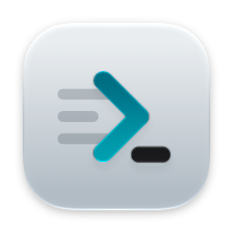
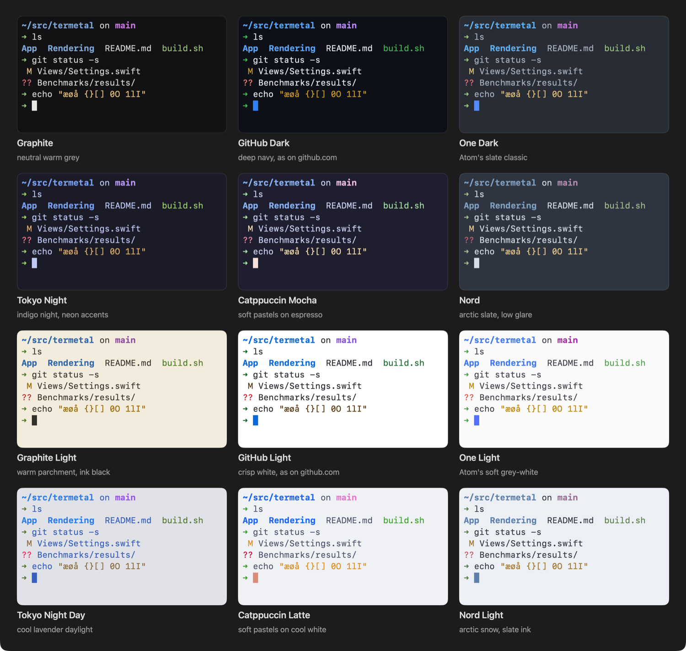

# Termetal

**A fast, native macOS terminal, drawn by the GPU.**

Written from scratch in Swift, with its own terminal emulator, a Metal renderer and a window
that feels at home on the Mac.

[Install](#install) · [Highlights](#highlights) · [Themes](#themes) · [Updates](#updates) · [Feedback](#feedback)

---

Termetal is an early version (0.x): things will change along the way. This repository holds
the releases and the feedback; the source is private for now.

## Install

1. **[Download Termetal.dmg](https://github.com/addvanced/termetal-releases/releases/latest/download/Termetal.dmg).**
   The link always gives the newest version.
2. Open it, and drag **Termetal** to **Applications** in the window that appears.
3. Eject the disk image and open Termetal from Applications. It's signed with Developer ID
   and notarized by Apple, so macOS opens it without warnings.

Needs **macOS 15 or later**, on Apple silicon or Intel. Older versions and their notes are
under [Releases](https://github.com/addvanced/termetal-releases/releases).

## Highlights

- **Fast.** 150 to 165 MB/s of output in every benchmark, and about 20 ms from key press to
  pixel. Nothing is drawn while nothing changes.
- **Projects.** Named groups of tabs that close and open again with everything in them.
- **Tabs your way.** In the title bar, or in a sidebar that stays open or slides in at the
  window's edge. Splits, zoom and keyboard navigation between panes.
- **Knows your commands.** With shell integration, each command shows whether it worked and
  how long it took, ⌘↑ and ⌘↓ jump between them, their output copies in one click, and a long
  one can notify you when it's done.
- **A built-in prompt** with the directory, Git branch and status, and language versions, if
  you want it. Your own zsh setup stays when you don't.
- **Find** in the history with ⌘F, or in every tab at once.
- **Quick Terminal.** A terminal one shortcut away, over any app, even in full screen.
- **Clickable links and paths.** ⌘-click opens a URL, or a file at its line in your editor.
- **Images** from programs such as `icat`, `imgcat` and `yazi`.
- **Comes back as you left it.** Windows, tabs and what they showed, after a restart.
- **Every keyboard layout.** Dead keys, Option characters (`@ { } [ ] | $` on Danish, German
  or French layouts) and input methods for Japanese, Chinese and Korean.
- **Plain-text settings** in a TOML file that applies the moment you save, with optional sync
  between your Macs through iCloud Drive.
- **Accessible.** VoiceOver can read and navigate the terminal, and Reduce Motion is respected.

## Themes

Six color schemes, each in a dark and a light version. Pick one for each, and Termetal switches
with macOS. The tabs, sidebar and Settings take their colors from the theme too, and a minimum
contrast setting keeps colors that programs chose readable on all of them.

## Updates

Termetal looks for a new version when it starts and when you come back to it after an hour,
and shows **Update** in the title bar when one is ready; click it to install. Nothing is
installed without asking.

- **Termetal › Check for Updates…** looks right away.
- **Settings › Updates** sets how often it looks (every hour, day or week, or never) and shows
  the notes of recent releases.

Your settings, sessions and Projects stay where they are.

## Feedback

Feedback is very welcome, small or large: **Help › Send Feedback…** opens a new issue here with
your Termetal and macOS versions filled in, or
[open an issue](https://github.com/addvanced/termetal-releases/issues/new) yourself.

It helps to say:

- the Termetal version (Termetal › About Termetal) and your macOS version,
- what you did, what you expected, and what happened instead,
- a screenshot or a short screen recording, when it's about how something looks.

If something is slow, **Help › Copy Performance Report** copies a few measurements you can
paste into the issue. It holds no commands, paths or terminal contents.

## Where Termetal keeps things

- **Settings:** `~/.config/termetal/settings.toml`. You can edit it by hand; changes apply
  right away.
- **Windows, tabs, Projects and what the panes showed:**
  `~/Library/Application Support/Termetal/Sessions/`, on this Mac only.
